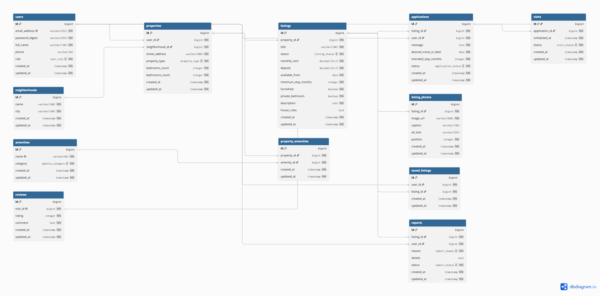

# webtech-assignments

# Roomies

A platform for renting rooms in shared homes. Hosts publish the free rooms in
their property; seekers browse them, apply, arrange a visit, and move in.

Semester project for **Web Technologies**, semester 202620.

---

## Team

| Name |
| --- |
| Javiera Carrasco Bastías|
| Andres Concha Arriaga|
| Rodrigo Ruz Vasquez|

---

## Repository structure

```
.
├── docs/
│   ├── user-stories.md        User stories for visitors, members and moderators
│   ├── Domain-Model.dbml      Domain model source, written in DBML (updated for Assignment 2)
│   ├── images/                Diagram exported from dbdiagram.io
│   └── desing-decisions.md    Modelling decisions, assumptions and changes since Assignment 1
├── roomies/                   Rails 8 application (Assignment 2 onwards)
└── README.md
```

## Running the application

The application lives in [`roomies/`](roomies). Its [README](roomies/README.md) has the full
instructions to install dependencies, create and seed the database, and start the app with `bin/dev`.

```bash
cd roomies
bundle install && yarn install
bin/rails db:create db:migrate db:seed
bin/dev            # http://localhost:3000
```

---

## Accounts, roles and API (Assignment 4)

Full details in [`roomies/README.md`](roomies/README.md): see *Accounts and roles*,
*Authorization (Pundit)* and *Public JSON API (v1)*.

### Credentials

Run `bin/rails db:seed` first. Every seeded user has the password **`password123`**.

| Role | Email |
| --- | --- |
| Moderator | `ignacio.fuentes@example.com` |
| Member (host) | `camila.rojas@example.com` |
| Member (host) | `matias.gonzalez@example.com` |
| Member (seeker) | `benjamin.morales@example.com` |
| Member (seeker) | `catalina.silva@example.com` |

### Roles

- **Visitor** (not signed in, not a value of the enum): browses the landing page, the search,
  the listing and property pages and the reviews. Everything else asks to log in.
- **Member** (`role: member`, the default for every new account): looks for a room as a seeker
  and publishes rooms as a host. Sees and manages only what they own: their properties,
  listings and drafts, the applications they sent and the ones their rooms received.
- **Moderator** (`role: moderator`): everything a member can do, plus seeing any draft and any
  application, editing or deleting any property, listing or review, resolving reports, and
  managing the neighborhoods and amenities.

Every model has a Pundit policy (`roomies/app/policies`); every action is checked in the
controller, and an unauthorized attempt lands on a 403 page that explains why. The complete
permission table is in [`roomies/README.md`](roomies/README.md).

### API endpoints

Public, read-only, versioned under `/api/v1`, without personal data. JSON with `data`,
`meta` and `links`; errors as `{ "error": { "status", "message", "details" } }`.

| Method and path | Description | Status codes |
| --- | --- | --- |
| `GET /api/v1/listings` | Published listings. Filters: `neighborhood_id`, `amenity_id`, `max_rent`, `available_by` (YYYY-MM-DD); `sort` (`newest`, `rent_asc`, `rent_desc`); `page`, `per_page` (1-50) | 200, 400 |
| `GET /api/v1/listings/:id` | One published listing with description and photos | 200, 404 |
| `GET /api/v1/neighborhoods` | Neighborhoods with their count of published listings | 200 |
| `GET /api/v1/amenities` | Amenities and shared spaces | 200 |

The search page (`/listings`) consumes `GET /api/v1/listings` with `fetch`.

---

## Domain model



**Online diagram:** https://dbdiagram.io/d/6a9ef6fa28e65f9ec240359d 

The source is in [`docs/domain-model.dbml`](docs/Domain-Model.dbml) and can be
re-rendered at any time by pasting its contents into
[dbdiagram.io](https://dbdiagram.io).

The model has twelve entities. Its backbone is the chain that follows a room
from publication to move-in:

```
users → properties → listings → applications → visits → reviews

